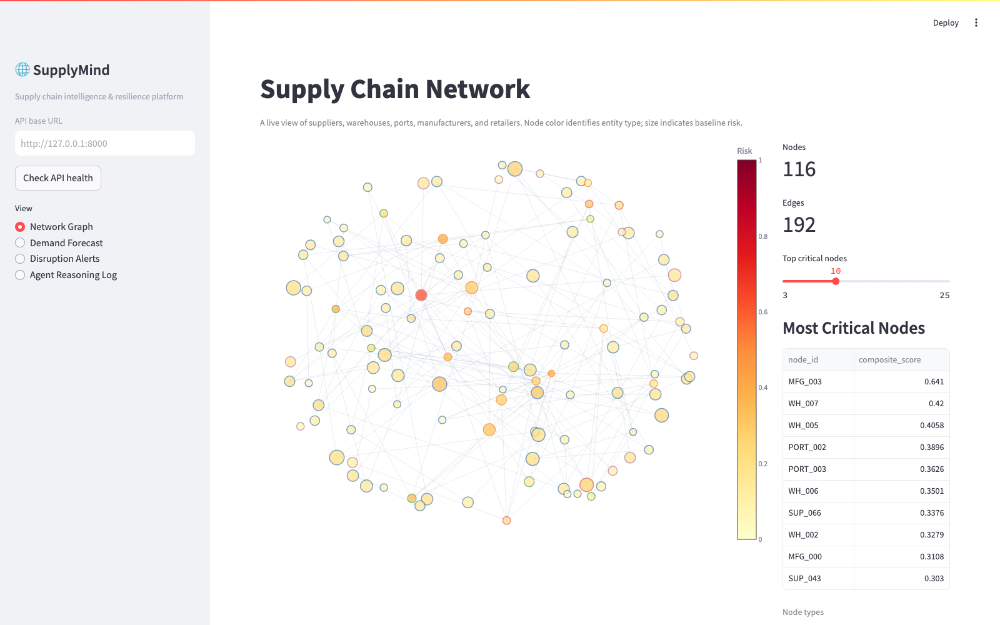
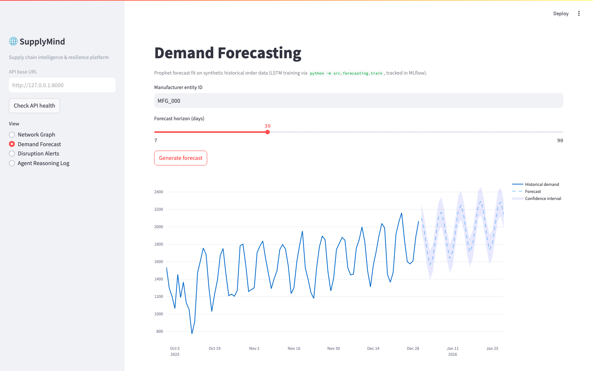
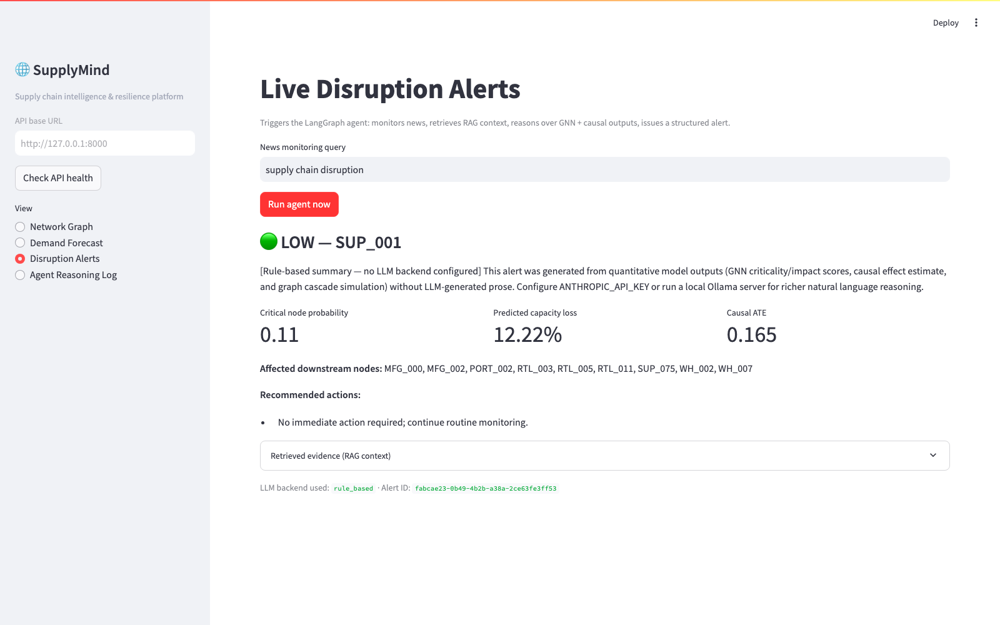
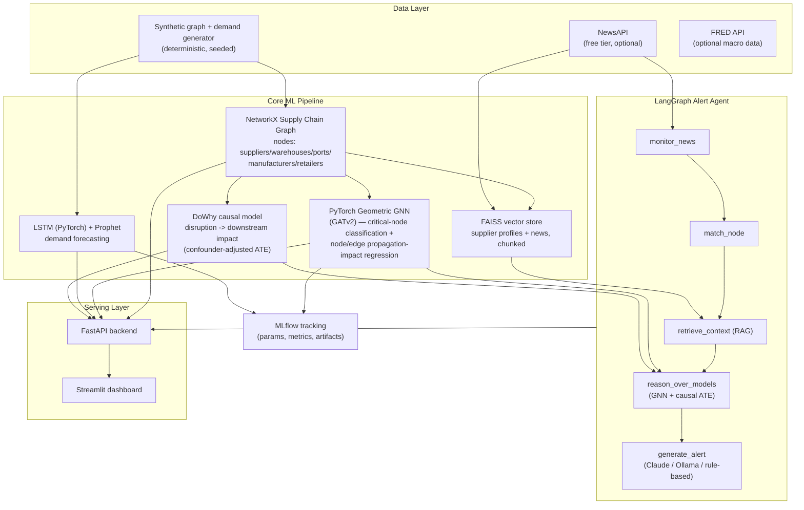

# SupplyMind

**Supply chain intelligence and resilience platform.** Models a global supplier network as a graph, trains a GNN to find structural failure points and predict node- and edge-level disruption propagation, forecasts 30 days of demand from 90-day LSTM input windows and Prophet, estimates the *causal* (not just correlational) effect of disruptions with DoWhy, and runs a LangGraph agent that monitors news, retrieves grounded context via RAG, and issues structured, severity-ranked alerts — all served through a FastAPI backend and a Streamlit dashboard, fully containerized.

Built as a portfolio project for a Master's in Applied Machine Learning (University of Maryland).

## Demo screenshots

**Network resilience:** 116 supply-chain entities, dependency links, structural risk coloring, and critical-node rankings.



**Demand forecast:** historical manufacturer demand with a 30-day forecast and uncertainty interval.



**Disruption response:** a structured alert generated by the agent with impact estimates and recommended actions.



---

## Architecture



### Design principles

- **Never blocks on external data.** Public supply-chain datasets don't ship a labeled graph with ground-truth failure propagation, so SupplyMind generates a structurally realistic, seeded synthetic network (tiered suppliers → ports/warehouses → manufacturers → retailers) with more than 100 nodes and synthetic demand history. NewsAPI integration is optional; synthetic news is used when no key is present.
- **Zero cost by default.** The LLM layer tries the paid Claude API only if `ANTHROPIC_API_KEY` is set, otherwise a local Ollama server (free), otherwise a deterministic rule-based narrative generator — the agent always produces a complete, schema-valid alert with no paid API required. Same philosophy for embeddings: `sentence-transformers` is used if installed, otherwise a TF-IDF+SVD fallback keeps RAG fully functional.
- **Fails loud, degrades gracefully.** Every external call (NewsAPI, FRED, Claude, Ollama) is wrapped in error handling that logs and falls back rather than crashing the pipeline.

---

## Tech stack

| Layer | Tools |
|---|---|
| Graph | NetworkX, Pydantic (schema validation) |
| GNN | PyTorch, PyTorch Geometric (GATv2Conv) |
| Forecasting | PyTorch (LSTM), Prophet, MLflow |
| Causal ML | DoWhy (identify → estimate → refute) |
| RAG | FAISS, sentence-transformers (TF-IDF fallback) |
| Agent | LangGraph, Anthropic Claude API, Ollama |
| APIs | NewsAPI, FRED API |
| Backend | FastAPI, Pydantic |
| Frontend | Streamlit, Plotly |
| Ops | Docker, docker-compose, MLflow, Python `logging` |

---

## Project structure

```
supplymind/
├── data/                    # generated at runtime: raw/, processed/, vector_store/, models/, logs/
├── notebooks/                # exploratory analysis (optional)
├── src/
│   ├── config.py             # env-driven settings (no hardcoded secrets)
│   ├── logging_config.py     # shared logging setup (no print())
│   ├── graph/                 # schema, synthetic data, graph builder, analytics
│   ├── gnn/                   # PyG data prep, GATv2 node/edge heads, training, inference
│   ├── forecasting/           # synthetic demand, LSTM, Prophet, training
│   ├── causal/                 # DoWhy pipeline + ATE caching
│   ├── retrieval/               # chunking, embeddings, FAISS store, ingestion
│   ├── agent/                   # NewsAPI client, LLM client, LangGraph agent, alert schema/store
│   └── api/                      # FastAPI app + routers
├── dashboard/app.py               # Streamlit UI (talks to the API only)
├── tests/                          # pytest suite
├── docker/                          # Dockerfile.api, Dockerfile.dashboard, docker-compose.yml
├── mlflow/mlruns/                    # MLflow tracking store
├── .env.example
├── requirements.txt
└── README.md
```

---

## Setup

### 1. Environment

```bash
git clone <your-repo-url> supplymind
cd supplymind
python3 -m venv .venv
source .venv/bin/activate        # Windows: .venv\Scripts\activate
pip install -r requirements.txt
cp .env.example .env
```

`.env` works out of the box with everything left as placeholders — the platform runs at **zero cost** with synthetic data, a rule-based alert narrator, and TF-IDF retrieval. Fill in real keys only if you want the upgrades below.

| Variable | Where to get it | Cost | Effect if unset |
|---|---|---|---|
| `ANTHROPIC_API_KEY` | https://console.anthropic.com/settings/keys | Paid | Agent falls back to Ollama, then rule-based narratives |
| `NEWSAPI_KEY` | https://newsapi.org/register | Free (dev tier) | RAG/agent use synthetic disruption headlines |
| `FRED_API_KEY` | https://fred.stlouisfed.org/docs/api/api_key.html | Free | Macro-context features simply unused |
| `OLLAMA_BASE_URL` | `ollama serve` after `ollama pull llama3.1` | Free (local) | Falls back to rule-based narratives |

### 2. Build the graph and demand data

```bash
python -m src.graph.build_graph          # generates + saves the synthetic supplier network
python -m src.forecasting.data_prep      # (optional, auto-runs on first forecast/train call)
```

The default seeded graph contains 116 nodes: 80 suppliers, 8 ports, 10 warehouses, 6 manufacturers, and 12 retailers. Synthetic disruption-news fallback content contains 100 scenarios, so RAG remains populated without API credentials. The LSTM trains on 90-day demand histories to produce a 30-day forecast; Prophet includes US holiday and reproducible synthetic economic-index regressors. Training reports both models' test metrics and the lower-MAE baseline.

### 3. Train the models (all logged to MLflow)

```bash
python -m src.gnn.train                  # GATv2 GNN — critical node + propagation impact
python -m src.forecasting.train          # LSTM + Prophet per manufacturer
python -m src.causal.causal_model        # DoWhy: identify -> estimate -> refute
```

Inspect runs:

```bash
mlflow ui --backend-store-uri file:./mlflow/mlruns
# open http://localhost:5000
```

### 4. Build the RAG index

```bash
python -m src.retrieval.ingest
```

### 5. Run the agent standalone

```bash
python -m src.agent.langgraph_agent
```

### 6. Run the API + dashboard

```bash
uvicorn src.api.main:app --reload --port 8000
# in a second terminal:
streamlit run dashboard/app.py
```

Open http://localhost:8501 for the dashboard, http://localhost:8000/docs for the interactive API docs.

### 7. Run tests

```bash
pytest tests/ -v
```

GNN tests are automatically skipped (`pytest.importorskip`) on machines without PyTorch Geometric installed.

### 8. Docker (all services)

```bash
cd docker
docker compose up --build
```

Brings up `api` (:8000), `dashboard` (:8501), and `mlflow` (:5000) on a shared network, with `data/` and `mlflow/` bind-mounted for persistence.

---

## Sample outputs

**Critical node detection** (composite betweenness + risk + unreliability score, from `GET /graph/critical-nodes`):

```json
[
  {"node_id": "WH_009", "composite_score": 0.722},
  {"node_id": "WH_005", "composite_score": 0.546},
  {"node_id": "SUP_002", "composite_score": 0.473},
  {"node_id": "SUP_003", "composite_score": 0.460},
  {"node_id": "WH_003", "composite_score": 0.451}
]
```

Trained GNN edge-level disruption impact estimates are available from `GET /gnn/edge-predictions`.

**Causal effect estimate** (`GET /causal/effect`, DoWhy backdoor-adjusted linear regression, refuted with placebo + random-common-cause tests):

```json
{
  "ate": 0.1647,
  "placebo_refutation_passed": true,
  "random_common_cause_refutation_passed": true,
  "summary": "Disrupting a node causes an estimated +0.165 fraction-of-network capacity loss downstream (on average), after adjusting for risk score, reliability, capacity, tier, and betweenness centrality as confounders."
}
```

**Agent-generated structured alert** (`POST /alerts/generate`, rule-based LLM tier shown; identical schema when Claude/Ollama are configured):

```json
{
  "alert_id": "1d527a1a-7f86-4bd7-86cf-e3d2415dd0ef",
  "severity": "medium",
  "origin_node": "SUP_007",
  "affected_nodes": ["MFG_000", "MFG_002", "PORT_003", "PORT_004", "WH_003", "WH_009"],
  "predicted_capacity_loss_fraction": 0.204,
  "critical_node_probability": 0.485,
  "causal_ate_estimate": 0.165,
  "news_trigger": "Port congestion reported at major East Asia shipping hub...",
  "recommended_actions": [
    "Flag for weekly review in the risk dashboard.",
    "Confirm current safety stock levels are adequate for a short-term disruption."
  ],
  "llm_backend": "rule_based"
}
```

---

## Notes on datasets

- **Graph + demand data**: synthetic by design (seeded, reproducible via `RANDOM_SEED` in `.env`) — real Kaggle "Supply Chain Resilience"-style CSVs can be mapped into `src/graph/schema.py`'s `Node`/`Edge` Pydantic models and swapped in for `generate_synthetic_graph_data()`.
- **News**: live via NewsAPI when `NEWSAPI_KEY` is set; otherwise 100 clearly identified synthetic disruption scenarios keep RAG/agent demos fully functional offline.
- **FRED**: an optional configuration placeholder for future macro-indicator integration; the current Prophet regressor is synthetic and does not call FRED.

## Engineering standards

- `logging` module everywhere — no `print()` statements in `src/`.
- All secrets loaded from `.env` (see `.env.example`); nothing hardcoded.
- Pydantic validation on graph ingestion (`src/graph/schema.py`) and all API request/response schemas (`src/api/schemas.py`).
- External calls (NewsAPI, Claude, Ollama) use bounded retries and graceful fallback; incompatible or stale vector/model artifacts are detected and reported.
- Test coverage spans graph construction/validation, GNN node and edge predictions, forecasting, causal analysis, retrieval, and API layers. GitHub Actions runs the full suite on Python 3.11.
